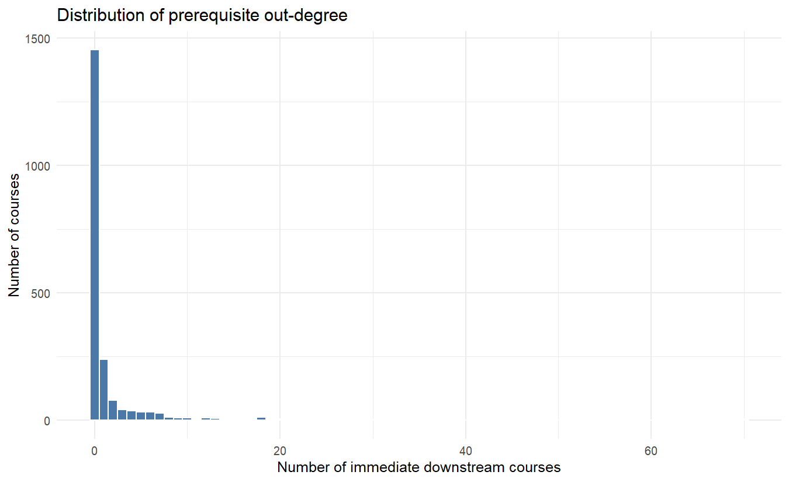

# RQ1 - Which courses occupy the most central positions in the prerequisite network?

**Scope.** 2,041 courses and 3,363 prerequisite edges from the shared UBCO network loader. The directed graph follows edge direction prerequisite -> course. Co-requisites and recommended courses are excluded. The graph is a DAG.

## Method
All calculations run in `RQ1_network_analysis.R` using the shared loader.

1. **In-degree**: number of direct prerequisite sources for a course.
2. **Out-degree**: number of courses that directly depend on a course.
3. **Betweenness centrality**: number of shortest prerequisite paths that pass through a course, normalized for the full network.
4. **Downstream reach**: number of courses reachable from a course.
5. **Prerequisite reach**: number of prerequisite ancestors of a course.
6. **PageRank**: importance based on the courses that point to it.
7. **Composite rank**: mean rank across betweenness, out-degree, downstream reach, and PageRank.

## Key findings
The complete rankings are in `output/tables/rq1_centrality_results.csv`; the top 20 are in `output/tables/rq1_top20_courses.csv`.

| Composite rank | Course | Immediate dependents | Downstream reach | Normalized betweenness |
|---|---|---:|---:|---:|
| 1 | FREN 223 | 10 | 12 | 0.0000173 |
| 2 | COMM 203 | 13 | 32 | 0.0000308 |
| 3 | STAT 230 | 19 | 26 | 0.0000593 |
| 4 | PHYS 121 | 23 | 60 | 0.0000348 |
| 5 | PHYS 122 | 23 | 60 | 0.0000348 |
| 6 | APSC 253 | 9 | 34 | 0.0000327 |
| 7 | CHEM 214 | 16 | 37 | 0.0000329 |
| 8 | COSC 123 | 5 | 43 | 0.0000120 |
| 9 | COSC 223 | 5 | 12 | 0.0000227 |
| 10 | COMM 204 | 6 | 21 | 0.0000268 |

- The composite ranking shows that centrality is distributed across several subjects rather than concentrated in only one area.
- MATH 100 and MATH 116 have especially large downstream reach (257 and 238 courses), and MATH 100 has 27 immediate dependents, even though neither appears in the composite top 10.
- STAT 230 has the highest normalized betweenness among the displayed composite leaders.

### Central-position overview

*Figure 1. Betweenness identifies courses that sit on many shortest prerequisite paths.*

*Figure 2. Courses with high betweenness are bridges, while courses with high reach unlock many downstream options.*

*Figure 3. Most courses have few direct dependents, while a small number have unusually large out-degree.*

## Interpretation
- A high out-degree identifies an immediate gateway: removing or failing the course affects its direct downstream courses.
- A high betweenness identifies a route bottleneck between distant parts of the network.
- High downstream reach identifies broad prerequisite foundations, even if they are not on the largest number of shortest paths.
- PageRank and downstream reach may rank entry-level courses highly because they feed many later courses.

## Limitations
- The network treats prerequisite edges as unweighted structural links; course requirements that use alternatives are not converted into AND/OR logic here.
- Retired codes remain in the network because later courses cite them.
- Standing, permission, credit-count, grade, offering-schedule, and program-restriction conditions are not represented as edges.
- Betweenness and reach describe the calendar network, not realized student enrollment or academic difficulty.

## Files
`RQ1_network_analysis.R` · `output/tables/rq1_centrality_results.csv` · `output/tables/rq1_top20_courses.csv` · `output/figures/rq1_betweenness.png` · `output/figures/rq1_reach_vs_betweenness.png` · `output/figures/rq1_out_degree_distribution.png`
