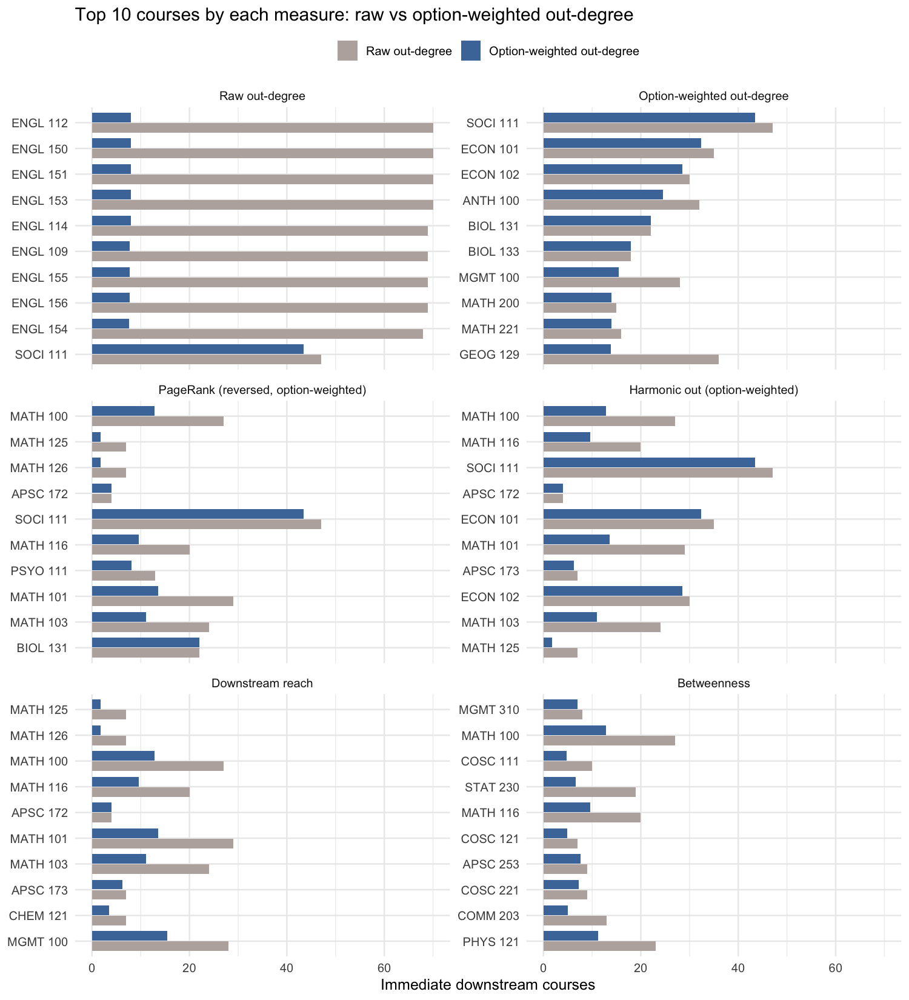
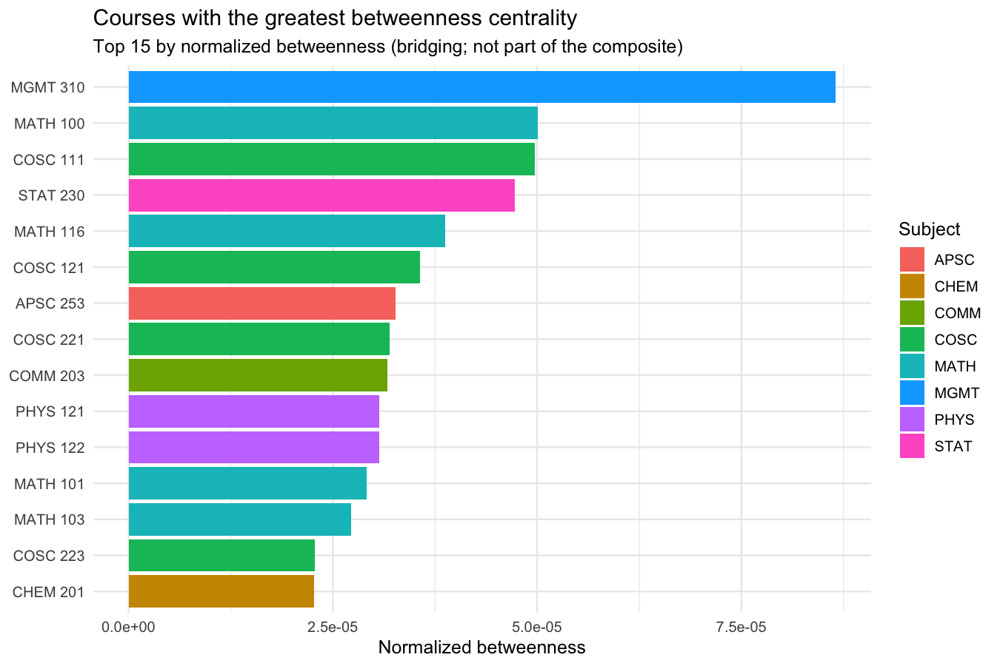
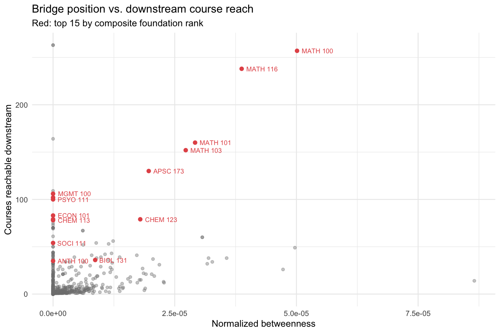

# RQ1 - Which UBCO courses are the most fundamental within the prerequisite network?

**Scope.** 2,041 courses and 3,363 prerequisite edges from the shared UBCO network loader (`type == "prereq"` only; co-requisites and recommended courses are excluded). Edges go prerequisite -> course, and the graph is a DAG. Most edges are not mandatory on their own: 2,042 are "one of" options, 299 are "two of" options, and 342 belong to "either (a) or (b)" whole-requirement alternatives.

## Method
All calculations run in `RQ1_network_analysis.R` using the shared loader.

**Handling alternatives.** The loader's `option_weight` says how much of a course's requirement one edge accounts for: 1 for a lone required course, 1/n for "one of n", 2/n for "two of n", divided again by the number of alternatives when the edge belongs to only some "either (a) or (b)" branches. Treating every edge as mandatory overstates courses that are one option among many. ENGL 112 is the clearest case: it has a raw out-degree of 70, but in each of those courses it is one choice among up to 13 first-year English courses. Its option-weighted out-degree is 8.00 and it is the sole mandatory prerequisite for 0 courses. Across the network, the 3,363 raw edges add up to 1,654 requirement-equivalents.

**Measures** (all in `output/tables/rq1_centrality_results.csv`):
1. **Out-degree** (raw), **option-weighted out-degree** (sum of `option_weight` over outgoing edges) and **mandatory dependents** (outgoing edges with `hard_requirement`).
2. **PageRank** on the reversed graph, so importance flows from a course back to its prerequisites: `pagerank` (unweighted) and `pagerank_weighted` (edge weight `option_weight`).
3. **Harmonic centrality** (normalized): `harmonic_out` and `harmonic_in` count path length in steps. `harmonic_out_weighted` gives each edge length 1 / `option_weight`, so a required edge is one step and one option out of four counts as four.
4. **Downstream reach** and **prerequisite reach**: number of descendants and ancestors.
5. **Betweenness** (directed, normalized, path length in steps).
6. **Composite foundation score**: mean percentile rank (0 = lowest, 1 = highest) of option-weighted out-degree, weighted PageRank, option-weighted harmonic and downstream reach. Betweenness is not in the composite: it measures bridging, not foundation, and is 0 for all 813 courses that have no prerequisites.
7. **Department structure** for the 46 subjects with 10 or more courses, using each subject's induced prerequisite subgraph: internal edges, density, average path length over reachable pairs, share of ordered pairs that are reachable, and longest shortest path.

The edge table has a `weight` column (1 / `n_alternatives`), and igraph uses an attribute with that name automatically when `weights` is not given. Every measure that should count steps passes `weights = NA` so that does not happen.

**Composite inputs.** The composite was first built from the unweighted `harmonic_out`. Checked against the data, that version still ranked ENGL 112 at #22, with five interchangeable first-year ENGL courses at #21-25. Unweighted harmonic and downstream reach both count every course reached through an option as fully dependent, so half of the composite ignored alternatives. Swapping in the option-weighted harmonic moves ENGL 112 to #45 and leaves no ENGL course in the top 30 (the highest is #42). Downstream reach stays unweighted as a plain measure of how far a course's influence extends.

## Key findings
The top 20 are in `output/tables/rq1_top20_courses.csv`.

| Rank | Course | Raw out-degree | Weighted out-degree | Mandatory dependents | Weighted PageRank | Downstream reach |
|---|---|---:|---:|---:|---:|---:|
| 1 | MATH 100 | 27 | 12.88 | 1 | 0.01194 | 257 |
| 2 | MATH 101 | 29 | 13.54 | 0 | 0.00598 | 160 |
| 3 | ECON 101 | 35 | 32.33 | 30 | 0.00479 | 83 |
| 4 | MATH 116 | 20 | 9.63 | 0 | 0.01031 | 238 |
| 5 | MGMT 100 | 28 | 15.50 | 4 | 0.00535 | 106 |
| 6 | SOCI 111 | 47 | 43.42 | 41 | 0.01067 | 54 |
| 7 | ECON 102 | 30 | 28.50 | 27 | 0.00401 | 79 |
| 8 | MATH 103 | 24 | 11.04 | 0 | 0.00577 | 152 |
| 9 | COMM 101 | 24 | 11.50 | 0 | 0.00477 | 102 |
| 10 | PSYO 111 | 13 | 8.17 | 4 | 0.00732 | 100 |

- **The most fundamental courses are first-year calculus and the introductory social-science and business courses.** MATH 100 ranks #1 on the composite and on weighted PageRank, and is second in betweenness. It reaches 257 courses, though it is the sole mandatory prerequisite for only one of them.
- **There are two kinds of foundation.** SOCI 111 (41 mandatory dependents), ECON 101 (30) and ECON 102 (27) are required outright by many courses. MATH 100, MATH 101, MATH 103 and MATH 116 reach more courses but almost always as one of several accepted options (0-1 mandatory dependents each). Only 325 courses are the sole mandatory prerequisite for anything.
- **Alternatives change the picture most for English.** Nine ENGL courses have a raw out-degree of 68-70, the highest in the network, but each has a weighted out-degree near 8 and no mandatory dependents.
- **Reach alone overstates interchangeable courses.** MATH 125 and MATH 126 reach the most courses (263 each) and rank #2-3 on weighted PageRank. They are one accepted route into MATH 100 and MATH 116 (one of two options within an "either/or" requirement), so everything downstream of first-year calculus counts toward their reach. All 7 of their outgoing edges are options, giving a weighted out-degree of only 1.75, so they rank #60-61.
- **Bridging is different from foundation.** 1,669 of the 2,041 courses have betweenness 0. The highest are MGMT 310 (8.65e-05, composite #79), MATH 100 (5.01e-05), COSC 111 (4.97e-05, #49) and STAT 230 (4.72e-05, #86). Only 4 of the top 15 by betweenness are in the composite top 15.

**Department structure** (`output/tables/rq1_department_structure.csv`, selected subjects):

| Subject | Courses | Internal edges | Density | Average path length | Reachable pairs | Longest shortest path |
|---|---:|---:|---:|---:|---:|---:|
| CRWR | 26 | 61 | 0.0938 | 1.32 | 13.4% | 3 |
| PSYO | 52 | 201 | 0.0758 | 1.35 | 11.0% | 3 |
| ENGL | 109 | 549 | 0.0466 | 1.00 | 4.7% | 1 |
| MATH | 46 | 53 | 0.0256 | 2.60 | 11.7% | 5 |
| COSC | 56 | 67 | 0.0218 | 2.17 | 7.3% | 5 |
| FREN | 35 | 23 | 0.0193 | 4.01 | 11.7% | 9 |

- CRWR and PSYO are the densest subjects, but their paths are short (at most 3 steps).
- ENGL is flat: all 549 internal edges run from 100-level courses to 200- and 300-level courses, with no longer chains.
- FREN has the longest sequence: few edges (density 0.0193), but they form a chain up to 9 courses long (average 4.01 steps). SPAN (7) and APSC (6) are next.
- 8 subjects (ARTH, DIHU, EDUC, EPSE, HINT, HMKN, LLED, WRLD) have no internal prerequisite edges.

### Figures

*Figure 1. The top 10 courses under each measure, with raw and option-weighted out-degree side by side. The raw out-degree panel is almost all ENGL; weighting removes that effect.*

*Figure 2. Raw and option-weighted out-degree (log scale). Most courses have no dependents. The raw tail at 68-70 is the ENGL option group; the weighted maximum is SOCI 111 at 43.4.*

*Figure 3. Top 15 by betweenness, reported separately from the composite.*

*Figure 4. Composite leaders (red) range from zero betweenness (ECON 101, SOCI 111, MGMT 100) to high betweenness (MATH 100).*

## Interpretation
- Weighted out-degree and mandatory dependents together separate "required by many" from "accepted by many". The raw count mixes the two.
- Reversed PageRank and option-weighted harmonic give credit for indirect influence, which is why MATH 100 ranks above SOCI 111 despite having far fewer mandatory dependents.
- Betweenness picks out mid-sequence courses (MGMT 310, STAT 230, COSC 111) that connect parts of the network. That matters for RQ2-style bottleneck questions, but it is not a measure of how fundamental a course is.

## Changes since the progress report
- **PageRank direction.** The earlier script ran PageRank forward, which rewarded courses at the end of chains (top three: CRWR 470, NRSG 437, EESC 423, all with no dependents). Run on the reversed graph, MATH 100 scores 0.01194, matching the progress report.
- **Harmonic centrality.** The earlier script's distance loops used the `weight` column as edge length, which made option edges shorter than required ones (MATH 100: 221.6 unnormalized). Counting steps reproduces the progress report's 0.05810 for MATH 100.
- **Betweenness** had the same problem. Counting steps, the number of courses with zero betweenness falls from 1,680 to 1,669, and MATH 100 rises from 3.37e-05 to 5.01e-05.
- **Composite.** The earlier composite averaged ranks including betweenness, so ties among the zero-betweenness courses decided the order. FREN 223 moves from #1 to #73, MATH 100 from #16 to #1, and ENGL 112 from #374 to #45.
- **Department structure** now comes from the script. CRWR (26 courses, density 0.0938), ENGL (109 courses, 549 edges, density 0.0466), MATH (46 courses, density 0.0256, average path length 2.60) and FREN (average path length 4.01, longest shortest path 9) all match the progress report.

## Limitations
- `option_weight` splits a requirement evenly among its options. The calendar does not say which option students actually take, so MATH 100 and MATH 125 get equal credit for the same slot.
- The composite weights its four measures equally. Across all courses they agree closely (Spearman 0.99 or higher, mostly because 1,453 courses have no dependents). Among the top 100 they disagree (weighted out-degree vs downstream reach: -0.02), so the top of the ranking depends on that choice.
- Retired codes stay in the network because later courses cite them. One appears in the top 20: CHEM 113 (#15), accepted as one option in the prerequisites of 14 courses.
- Department subgraphs leave out cross-department prerequisites, such as MATH courses required by PHYS.
- Standing, permission, credit-count, grade, offering-schedule and program-restriction conditions are not represented as edges.
- All measures describe the calendar network, not actual enrolment or course difficulty.

## Files
`RQ1_network_analysis.R` · `output/tables/rq1_centrality_results.csv` · `output/tables/rq1_top20_courses.csv` · `output/tables/rq1_department_structure.csv` · `output/figures/rq1_top10_by_measure.png` · `output/figures/rq1_out_degree_distribution.png` · `output/figures/rq1_betweenness.png` · `output/figures/rq1_reach_vs_betweenness.png`
