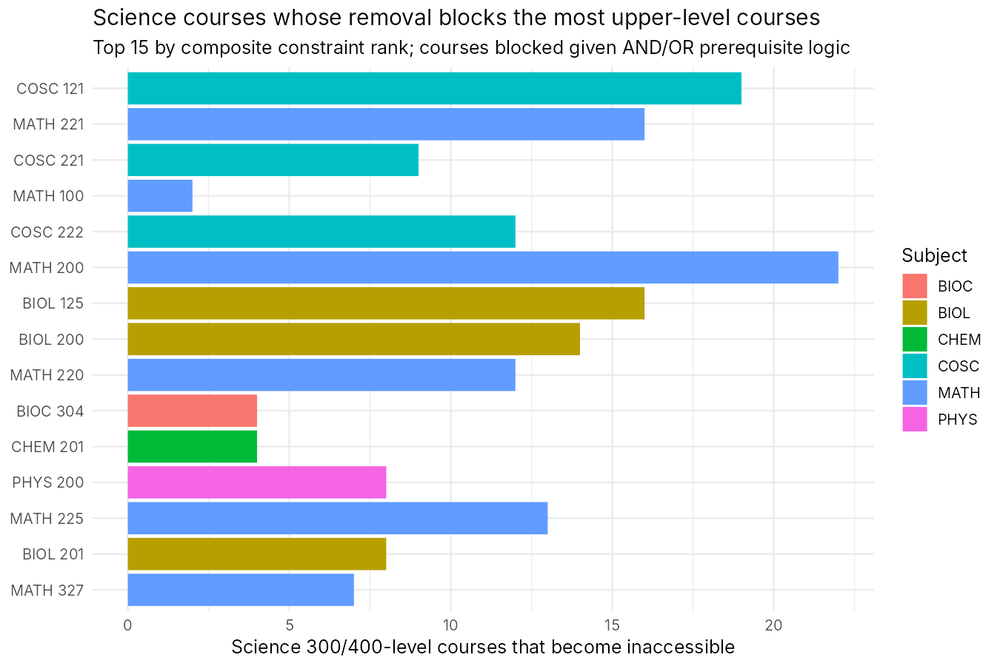
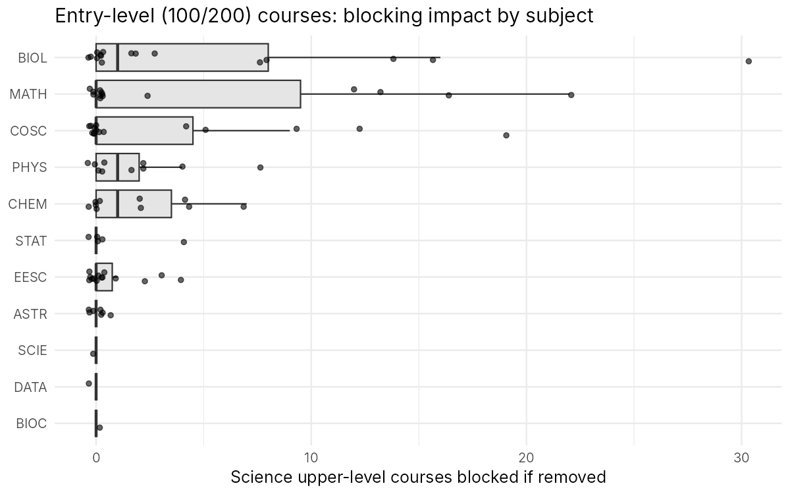
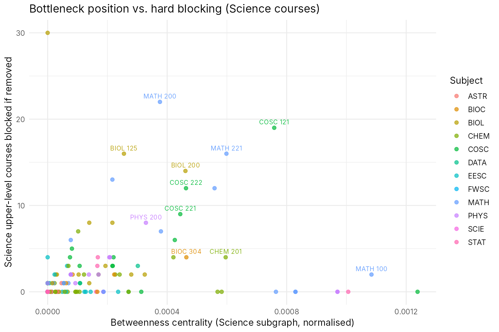

# RQ2 – Which prerequisite courses create the greatest access constraints in Faculty of Science programs?

**Scope.** 361 current Science courses (ASTR, BIOC, BIOL, CHEM, COSC, DATA, EESC, FWSC, MATH, PHYS, SCIE, STAT), 267 of them at the 300/400 level. Network: 2,041 courses, 3,363 prerequisite edges (co-requisites and "recommended" links excluded). The network is a DAG, so prerequisite chains are well defined.

## Method (all in `RQ2_network_analysis.R`)
1. **Betweenness centrality** (directed, normalised) on the full network and on the Science-only subgraph, as proposed.
2. **Downstream reach**: number of Science 300/400-level courses reachable from each course.
3. **Removal (what-if) analysis**: each course's requirement is rebuilt as AND/OR clauses (required / one-of / two-of / "either (a) or (b)"), then each Science course is removed and we count the Science upper-level courses that can no longer be reached. This was added because betweenness alone treats every edge as mandatory, while most UBCO prerequisites offer alternatives.
4. **Composite constraint rank**: mean rank across betweenness, reach and hard blocking.

## Key findings
**Courses that block the most upper-level Science courses when removed**

| Course | Upper-level Science courses blocked | Directly | Subjects affected |
|---|---|---|---|
| BIOL 116 Biology for Science Majors I | 30 | 0 | 3 |
| MATH 200 Calculus III | 22 | 13 | 5 |
| COSC 121 Computer Programming II | 19 | 1 | 1 |
| MATH 221 Matrix Algebra | 16 | 11 | 5 |
| BIOL 125 Biology for Science Majors II | 16 | 0 | 1 |
| BIOL 200 Cell Biology | 14 | 9 | 3 |
| MATH 225 Differential Equations | 13 | 8 | 2 |
| COSC 222 Data Structures | 12 | 9 | 1 |
| MATH 220 Mathematical Proof | 12 | 4 | 1 |

### Constraint overview

*Figure 1. The removal-impact ranking identifies bottlenecks that would block upper-level Science course access.*

*Figure 2. Entry-level courses in BIOL and MATH account for a large share of the blocking impact.*

*Figure 3. Betweenness centrality and upper-level blocking measure different kinds of access constraints.*

**Composite top 5:** COSC 121, MATH 221, COSC 221, MATH 100, COSC 222.

- **Optional-looking courses can be hidden bottlenecks.** MATH 200 (the example in the proposal) is not needed by every program, yet it is a required prerequisite for 22 upper-level courses across five subjects. MATH 221 reaches five subjects too.
- **Highest betweenness is not the same as highest constraint.** COSC 111 (160), MATH 100 (140), STAT 230 (130), PHYS 121/122 (125) lead on betweenness, but removing any one of them blocks 0–2 upper-level courses because students can enter through alternatives (MATH 100 reaches 137 upper-level courses yet blocks only 2). These are busy *routes*, not single gates.
- **Betweenness cannot see entry courses.** Courses with no prerequisites of their own always score 0. BIOL 116 is the clearest case: betweenness 0, but BIOL 125, BIOL 200 and BIOL 265 strictly require it, which cascades into 30 upper-level courses. The removal analysis is what surfaces it.
- **Only 73 of 361 Science courses block anything on their own**, so the constraint is concentrated in a small core of first/second-year courses in COSC, MATH and BIOL.
- **Upper-level courses with the most single points of failure** (6 each): COSC 417, COSC 433, COSC 434, BIOL 426, MATH 409, PHYS 418. COSC 417/433/434 also have the longest prerequisite chains (8 courses deep). 146 of 267 upper-level Science courses have at least one single point of failure. Average per course: COSC 1.78, PHYS 1.78, BIOL 1.71, STAT 1.62, MATH 1.47, versus DATA 0.33 and EESC 0.38, so CS, Physics, Biology and Stats specializations are the most sequence-constrained, while Earth/Environmental Sciences and Data Science are the most flexible.
- **Cross-subject dependencies:** the largest are MATH → PHYS (24 blocked course pairs) and BIOL → BIOC (10); most other blocking stays within a subject (BIOL→BIOL 80, COSC→COSC 70, MATH→MATH 45, CHEM→CHEM 28).

## Limitations
- Standing, permission, credit-count and program restrictions are not edges, so blocking counts are a **lower bound**.
- The edge table does not identify which one-of options belong together. Groups are inferred from `n_alternatives`; two groups of equal size on one course are merged, which slightly **understates** blocking.
- Retired course codes are treated as always available.
- High-school and placement equivalents are not modelled (they appear only in the calendar text).
- "Specializations" are approximated by subject and by 300/400-level courses, since the data has no program requirement lists.
- Offering schedules and grade thresholds are not considered.
- PSYO is not treated as Faculty of Science; add it to `SCIENCE_SUBJECTS` at the top of the script if your program counts it.

## Files
`RQ2_network_analysis.R` · `RQ2_constraint_results.csv` · `RQ2_removal_impact_detail.csv` · `RQ2_upper_level_constraints.csv` · `RQ2_subject_impact.csv` · `RQ2_figures/` (3 PNGs)
